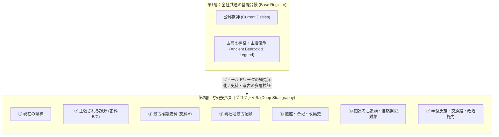

# ADR-0019: 祭祀拠点（旧・重要聖地）の重層構造・祭神コンテキスト・探索ジャーニー統合アーキテクチャ

- Status: Accepted
- Date: 2026-10-18
- Related ADRs:
  - [`0001-local-first-evidence-graph.md`](./0001-local-first-evidence-graph.md)
  - [`0003-separate-claim-kind-from-evidence-nature.md`](./0003-separate-claim-kind-from-evidence-nature.md)
  - [`0013-project-sacred-landscapes-through-existing-lenses.md`](./0013-project-sacred-landscapes-through-existing-lenses.md)
  - [`0017-topic-grounding-and-abstraction-principles.md`](./0017-topic-grounding-and-abstraction-principles.md)
  - [`0018-evidence-driven-stratum-and-anti-bias-guards.md`](./0018-evidence-driven-stratum-and-anti-bias-guards.md)
- Related Docs:
  - [`docs/source-evaluation-and-stratigraphy-policy.md`](../source-evaluation-and-stratigraphy-policy.md)

---

## 1. Context (背景と課題意識)

### 1.1 地点インスペクターにおける祭神・古層コンテキストの欠落
探索アトラスの地点インスペクター（`AtlasSpotInspector`）において、神社スポットを選択した際に「祭神」や「本来祀られていた神格・伝承」の表示領域が存在しなかった。
特に、旅行記（フィールドワーク）において極めて重要な洞察が得られた拠点（例：『邪馬台国探索2』における**筑紫神社**の「筑紫の神＝峠の境界神・人の命を奪う荒ぶる神」「筑紫の国名起源」「粥占神事」）であっても、地点を振り返った際にそのコンテキストが参照できず、探索体験の再現性が損なわれていた。

### 1.2 「重要聖地」概念の罠（大社中心主義と固定ヒエラルキーの懸念）
既存システムには `SACRED_SITE_STRATIGRAPHY_PROFILES`（16拠点）が実装されていたが、これらは宗像・出雲・宇佐・住吉など全国区の著名な大社（名神大社・一宮）が中心であった。
安易に「重要聖地」と「一般神社」の二階層を固定化してしまうと、以下の弊害が生じる：
1. **大社中心主義（バイアス）の固定化**：近代以降の知名度や国家格式を基準にしてしまい、古代地政学上の要衝（峠・国境・水系結節点）に鎮座する地方古社が不当に周縁化される。
2. **探索ジャーニー（フィールドワーク）との乖離**：著者が実際に現場を歩き、地形と伝承から得た「生きた発見（Claim）」が、机上の大社カタログに反映されない。

---

## 2. Decision (設計原則と正本ルール)

本合意に基づき、祭祀拠点の情報構造および「重要聖地」のあり方について以下の原則を正本とする。

### 原則 1: 「大社中心主義」の脱却と多軸的評価
拠点の重要度を、近代的な観光知名度や単一の国家格式（式内社・一宮）のみで格付けすることを禁止する。以下の3軸のいずれか（または複合）において価値を持つ拠点を等しく尊重する：
- **軸A（制度・格式軸）**：延喜式内社、国史見在社、一宮などの古代公的制度における記録。
- **軸B（古代地政・境界軸）**：国境、峠、海峡、古代交通路の要衝、古代地名発祥地（例：筑紫神社、大己貴神社）。
- **軸C（探索ジャーニー軸）**：フィールドワークにおいて、現地の地形・巨石・湧水・社伝・祭事から著者が独自の問いやインサイトを得た拠点。

### 原則 2: 「固定ヒエラルキー」から「解像度のグラデーション（成長型）」へ
「選ばれた16社だけが特別」という固定的クラス分けを廃止し、**調査・分析の深度（Depth）に応じた進展型モデル**を採用する。

- **全社共通（Base）**：データセット内のすべての神社は、等しく「現在の公称祭神」と「古層の神格・由緒伝承（1〜2行の核）」を持つ。
- **深層分析（Deep Stratigraphy）**：考古物証や史料層の矛盾・重層性が深く問われる拠点、または旅行記で深く踏み込んだ拠点（筑紫神社など）は、7項目プロファイルへと順次昇格・多層化する。

### 原則 3: 「公称祭神」と「古層の神格・由緒伝承」の2段分離表示
神社の祭神情報は、1行に要約せず必ず以下の2段構成で表示する：
1. **現在の公称祭神**：記紀神話の神名、近代社格や国家神道下で公称化された神名（五十猛命、素戔嗚尊など）。
2. **古層の神格・由緒伝承**：古代地誌・地方伝承・旅行記の着眼点による本来の神格（峠の境界神、人の命を奪う荒ぶる神、地名起源、神事など）。

### 原則 4: 単一情報源（Single Source of Truth）と解決順序
データソースの重複や矛盾を防ぐため、UIは以下の優先順位を持つ単一の解決関数（`resolveSpotDeityContext`）を介して情報を取得する：
1. `resolveSpotStratigraphyProfile(spot)`（7項目プロファイル定義済みの拠点）
2. `SHRINE_DEITY_REGISTRY`（全社カバー用軽量辞書）
3. スポット自身の Claims / 解説文

### 原則 5: 非神社スポットへのUIノイズ化防止（Zero Noise Guard）
`kind === "神社"` または神社コンテキストを保持する場合にのみカードを描画し、博物館・山城・古墳・駅・温泉・飲食店等の非神社スポットのインスペクター体験を一切阻害しない。

---

## 3. Implementation Steps (実装手順)

1. **ドメイン型と解決ロジックの新設**:
   - `apps/web/src/domain/knowledge/shrine-deity-registry.ts` を作成。
   - `SpotDeityContext` 型の定義、全神社対応の軽量辞書 `SHRINE_DEITY_REGISTRY`、および `resolveSpotDeityContext` を実装。
2. **筑紫神社の深層プロファイル化とデータセット連携**:
   - `stratigraphy-profiles.ts` に筑紫神社（`stratigraphy-chikushi-jinja`）の7項目プロファイルを追加。
   - `published-review-dataset.json` の筑紫神社スポットに、『邪馬台国探索2.txt』のエビデンス（峠の境界神・筑紫の国名起源・粥占）を Claim として正式登録。
3. **インスペクターUIの拡張**:
   - `apps/web/src/app/review/atlas-spot-inspector.tsx` に「⛩️ 祭神・古層の神格」カードを追加。
   - `atlas.module.css` に気品ある神社カード用スタイルを追加。
4. **テスト・型検査の実施**:
   - 新規ロジックの単体テストを追加し、既存全テストがパスすることを確認。
