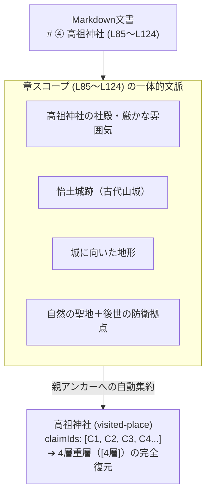

# ADR-0020: 旅行記の章（セクション）スコープによるClaim自動継承と文脈保全原則

- Status: Accepted
- Date: 2026-10-18
- Related ADRs:
  - [`0001-local-first-evidence-graph.md`](./0001-local-first-evidence-graph.md)
  - [`0007-accept-progressive-multi-journey-import.md`](./0007-accept-progressive-multi-journey-import.md)
  - [`0017-topic-grounding-and-abstraction-principles.md`](./0017-topic-grounding-and-abstraction-principles.md)
  - [`0018-evidence-driven-stratum-and-anti-bias-guards.md`](./0018-evidence-driven-stratum-and-anti-bias-guards.md)
  - [`0019-sacred-site-stratigraphy-and-deity-context-architecture.md`](./0019-sacred-site-stratigraphy-and-deity-context-architecture.md)
- Related Docs:
  - [`docs/data-structure-policy.md`](../data-structure-policy.md)
  - [`docs/source-evaluation-and-stratigraphy-policy.md`](../source-evaluation-and-stratigraphy-policy.md)

---

## 1. Context (背景とインシデント分析)

高祖神社（福岡県糸島市）において、本来は「自然神体山祭祀・古代山城（怡土城跡）・律令式内社・中世城郭（高祖城跡）」という4つの時代層を持つ重層拠点であるにもかかわらず、システム上で第3層（延喜式）のみの単層（1層）として過小評価される不整合が発生した。

### 根本原因の構造的解明
旅行記『邪馬台国探索1』の第④章「高祖神社」において、著者は以下の観察を一体として記録していた：
1. 「高祖山を背負った社殿」
2. 「さらに高祖山には**怡土城跡**がある」
3. 「これは城を作るのに向いている地形だな」
4. 「自然の聖地 ＋ 平野を見渡す場所 ＋ 後世の防衛拠点 という複数の意味を持っている」

しかし、LLMによる文単位の固有表現抽出において、「高祖山」という名詞が出た文のClaimがすべて背景スポット「高祖山（area-context）」にのみ紐付けられ、章の主役である訪問地点「高祖神社（visited-place）」の `claimIds` から脱落した。
その結果、高祖神社には城郭・地形に関するClaimが1件も渡らず、地層判定が単層に縮退してしまった。

---

## 2. Decision (設計原則と正本ルール)

大掛かりで維持コストの高いオントロジー（用語体系の構築）を避け、**旅行記本来の自然な文章構造（Markdownの見出し・章立て）をそのまま地点の文脈境界として扱う「章スコープ継承原則」**を採用する。

### 原則 1: 章スコープ継承（Section-Scope Claim Inheritance）
旅行記の見出し（H1〜H3）によって区分された特定の訪問スポットの章（例：`# ④ 高祖神社`）の行範囲（`startLine`〜`endLine`）内で抽出されたすべての観察Claimは、個別の文の主語が山・城跡・巨石・神事等の名詞であっても、**その章の基幹訪問スポット（親アンカー）の `claimIds` に自動的に包含・継承される**。

### 原則 2: 比較・回想文脈のコンタミネーション防止（Cross-Site Guard）
章内で他地域の登録スポット（例：「昨日の宗像大社と違って…」「出雲や三輪山と比べると…」）が言及された場合、Claimの主語がその外部スポットを直接対象としている命題は、章スポットの固有Claimとしては継承せず、比較接続（Comparative Connection）として分離する。

### 原則 3: 見出し階層（H1〜H3）の柔軟マッチング
見出しの深さ（#の個数）に依存した固定解析を禁止する。旅程ごとに異なる見出し階層（H1/H2/H3）に対応するため、**「登録スポットの名称を含む見出し」を動的な章の境界マーカー**として行範囲を算出する。

### 原則 4: 総括・移動セクションの独立（Summary Section Separation）
「旅の概要」「今回の旅を一言でまとめると」「筑紫平野を3D地形として理解」などの広域・総括セクションは、特定の個別スポットへ誤吸着させず、ジャーニー全体（Journey Scope）またはエリアコンテキスト（Area Context）のClaimとして独立して保持する。

### 原則 5: CI自動監査テスト（Orphaned Section Claim Audit）の配備
「同一章内で抽出されたClaimが、章のメインスポットの `claimIds` から脱落していないか」を行番号レベルで自動照合するCIテストを常設し、将来新しい旅行記を取り込んだ際にも文脈の脱落を即座に検知・防止する。

---

## 3. Consequences (期待される効果)

- **保守性の最大化**: 際限のない用語オントロジーを管理することなく、著者のMarkdown原稿の記述構造から自動的かつ安全に地点の歴史的コンテキストが保全される。
- **重層性の真実性担保**: 高祖神社のような「神体山＋古代城郭＋式内社＋中世山城」という現場の複合的な体験が、一切の脱落なく多層オーラ（`[4層]`）として地図上に現れる。
