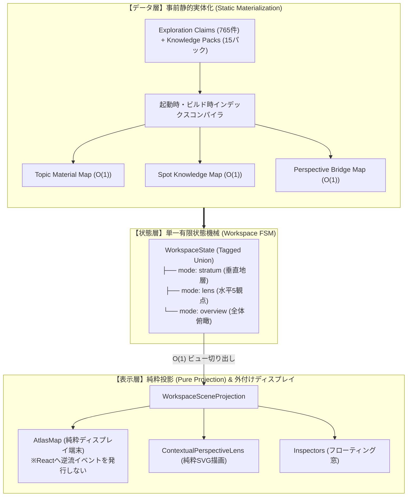

# ADR-0021: 垂直地層・水平観点の二大認知直交モデルと、事前実体化・単一状態マシン（FSM）アーキテクチャ

- Status: Accepted
- Date: 2026-10-21
- Supersedes:
  - [`0012-separate-map-connection-selection-from-focus.md`](./0012-separate-map-connection-selection-from-focus.md)（状態の独立・相互更新モデルを完全撤廃し、単一FSMによる合成フォーカスへ統一）
  - [`0010-limit-top-level-lenses-and-use-shared-axes.md`](./0010-limit-top-level-lenses-and-use-shared-axes.md)（「5つのLENSのみ」の制約を改定し、垂直STRATUMと水平5LENSの直交二大モデルを公認）
  - [`0011-separate-exploration-scope-from-lens.md`](./0011-separate-exploration-scope-from-lens.md)（二段階操作モデルを「Scope ➔ 探索モード [STRATUM / LENS / OVERVIEW] ➔ Projection」へ改定）
  - [`0005-separate-knowledge-from-view-projections.md`](./0005-separate-knowledge-from-view-projections.md)（Domain Projectionの責務を「事前静的実体化」と「ランタイムビュー投影」に厳格分離）
- Related ADRs:
  - [`0001-local-first-evidence-graph.md`](./0001-local-first-evidence-graph.md)
  - [`0014-knowledge-frontier-connections-and-next-candidates.md`](./0014-knowledge-frontier-connections-and-next-candidates.md)
  - [`0015-unified-lens-connection-data-model.md`](./0015-unified-lens-connection-data-model.md)
  - [`0018-evidence-driven-stratum-and-anti-bias-guards.md`](./0018-evidence-driven-stratum-and-anti-bias-guards.md)
  - [`0019-sacred-site-stratigraphy-and-deity-context-architecture.md`](./0019-sacred-site-stratigraphy-and-deity-context-architecture.md)

---

## 1. Context (背景と過去ドキュメントの足枷)

### 1.1 連続クリックフリーズおよびモード切り替え不全のインシデント
新機能（観点拡大・候補地ポップアップ）を追加した際、以下の深刻な障害が連続して発生した：
1. **連続クリック時のメインスレッド凍結・ブラウザクラッシュ**:
   地点をクリックするたびに、トピック解決（`resolveLensTopics`）およびスポット知識解決（`resolveSpotKnowledgeContexts`）が、全15パック・765クレーム・126スポットに対する多重ループとUnicode正規化を同期実行し、1回のクリックで約900ms〜1,000msもCPUを占有していた。
2. **STRATUM ↔ LENS 切り替え不能・無限再描画ループ**:
   `explorationMode`、`selectedRecognitionLens`、`selectedLensTopicId`、`selectedStratumIds`、`selection.focus` が独立した `useState` として並立し、複数の `useEffect` を介して双方向に状態を同期しようとした結果、円環参照と無限ループに陥った。

### 1.2 過去の ADR がもたらした 4 つの構造的足枷
これらの障害は単なる実装ミスではなく、**過去の ADR に残存していた当時の妥協や古い前提**が原因であった：
- **足枷 1 (ADR-0012 の誤謬)**:
  「接続線・地点・カメラ・LENSを独立状態とし、相互作用によって更新する」と定めたため、状態の直積（$A \times B \times C$）と `useEffect` による場当たり的な相互同期が正当化されてしまった。
- **足枷 2 (ADR-0010 / 0011 の前提不整合)**:
  STRATUM（全5層の垂直地層断面）が確立される前に「トップレベルLENSは5つのみ」「Scope ➔ LENS の二段階」と決めたため、STRATUM が `isStratum: true` という裏口フラグで扱われ、UIの二重管理と切り替え破壊を招いた。
- **足枷 3 (ADR-0005 の時間軸の欠落)**:
  `Domain Projection` の概念において、「いつ計算すべきか」が未定義だったため、巨大なグラフ探索が React コンポーネントのレンダリングパス（`useMemo`）の中で実行されることを許してしまった。
- **足枷 4 (ADR-0014 の存在論の曖昧さ)**:
  候補地（Suggestion）が「地点（Spot）」とどう排他的に関係するかが未定義だったため、モード切替時に候補地ポップアップが取り残される等のバグを生んだ。

---

## 2. Decision (あるべき設計憲章と新アーキテクチャ)

本決定をもって過去の足枷を断ち切り、ResoWorld のコアコンセプトに完全に整合した以下の 5 原則を正本アーキテクチャとする。



### 原則 1: 垂直（STRATUM）と水平（LENS）の二大直交モデル (Orthogonal Dual-Cognitive Planes)
- ResoWorld の認識論モデルは「Scope ➔ LENS」ではなく、**「Scope ➔ 探索モード [STRATUM / LENS / OVERVIEW] ➔ Projection」** の三段階とする。
  1. **垂直の時代地層（STRATUM）**: 同一空間における全5層の歴史的堆積（重層度）。
  2. **水平の認知観点（LENS）**: 5大観点（神話・宗教・ルート・政治・人物）による関係性ネットワーク。
  3. **全体俯瞰（OVERVIEW）**: 観点や地層のフィルターを外した、全旅程の素朴な地理的観察面。
- これらは直交する排他的な探索面であり、型システム上も排他的直和（Tagged Union）として定義する。STRATUM を LENS の中に裏口で押し込めることを恒久的に禁止する。

### 原則 2: 事前実体化・ランタイム投影 (Compile-time Materialization, Runtime Projection)
- **知識グラフは静的な宇宙であり、UIスレッドで動的に探索するものではない**。
- スポット・クレーム・ナレッジパック間の照合、トピックの所属、観点間ブリッジは、アプリ起動時（または静的ビルド時）に $O(1)$ のルックアップテーブルとして一度だけ実体化（Materialize）する。
- UI コンポーネントおよびフックがレンダリングパス内で行ってよい処理は、完成している辞書からの**キー引き（`Map.get(id)`）または単一スライスの切り出しのみ**とする（所要時間 0.001ms 未満）。

### 原則 3: 型による不正状態の排除（Make Illegal States Unrepresentable）と単一 FSM
- ADR-0012 の「状態の独立並立と相互更新」を破棄し、**単一の有限状態機械（Workspace FSM）**で画面全体のモードとフォーカスを統括する。
  ```ts
  export type WorkspaceModeState =
    | {
        kind: "stratum";
        selectedStratumIds: readonly string[];
        selectedSpotId?: string; // 候補地やLENSトピックは型として存在し得ない
      }
    | {
        kind: "lens";
        perspectiveId: LensPerspectiveId;
        topicId: string;
        selectedNodeId?: string;
        selectedSpotId?: string;
        selectedSuggestionId?: string;
      }
    | {
        kind: "overview";
        selectedSpotId?: string;
        selectedSuggestionId?: string;
      };
  ```
- モード切り替え、地点選択、候補地選択はすべて FSM への純粋アクションディスパッチとして処理し、コンポーネント間で `useEffect` を使った状態の同期・バケツリレーを行うことを厳禁とする。

### 原則 4: 地図（MapLibre）の「純粋ディスプレイ端末」化 (Unidirectional Display Terminal)
- **MapLibre は外付けモニターと同じであり、状態を持たない従属デバイスである**。
- React の FSM が唯一の真実（Single Source of Truth）であり、MapLibre は渡されたシーンデータ（ピン、接続線、カメラ位置）を描画するだけのプロジェクタとする。
- ユーザーの手動パン・ズーム以外の、MapLibre 側のアニメーション完了や移動イベントが React 側のビジネス状態（選択地点・モード等）を再書き換えすることを設計境界として断絶する。

### 原則 5: 構造的 $O(1)$ パフォーマンス保証 (Performance by Construction)
- UI 層に公開されるインターフェースは、キー引き（`Map.get`）または事前計算済みセレクタに限定する。
- 配列を全走査する関数や Unicode 正規化ループを伴う関数を UI コンポーネントから直接呼び出すことを設計違反とし、CI（パフォーマンス予算テスト）で即座に遮断する。

---

## 3. Consequences (もたらされる結果と設計純度の向上)

1. **認知的・設計的純度の回復**:
   - STRATUM と LENS の役割が明確に分離され、コード上からも `isStratum: true` などの裏口フラグや、UI 側での場当たり的な出力上書き（`effectiveMapScene` / `effectiveSuggestions` のサルベージ処理）が完全に消滅する。
2. **フリーズ・クラッシュの根絶**:
   - ユーザーが地点や候補地をどれだけ高速に連打しても、実行されるのは $O(1)$ のキー引き（0.001ms）のみとなり、メインスレッドがブロックされる要因が物理的に消滅する。
3. **無限再描画ループの根絶**:
   - 状態が Tagged Union で一元管理され、MapLibre からのフィードバック逆流が遮断されるため、状態競合（Race Condition）や無限ループが原理的に発生し得なくなる。
4. **拡張性の保証**:
   - 今後旅行記が 100 件、ナレッジパックが 50 個に増えても、UI の描画パフォーマンスは 1 ミリ秒も劣化しない。
