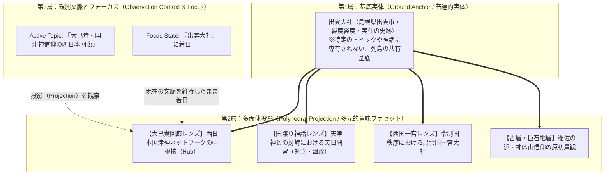

# ADR-0022: 基底実体（Ground Anchor）と多面体投影（Polyhedral Projection）モデル、および認知文脈不変性（Context Invariance）憲章

- Status: Accepted
- Date: 2026-10-22
- Supersedes:
  - なし（ADR-0021 を認識論・ドメイン存在論・インタラクション規約の観点から拡張・完全化）
- Related ADRs:
  - [`0021-dual-cognitive-orthogonality-and-fsm-architecture.md`](./0021-dual-cognitive-orthogonality-and-fsm-architecture.md)
  - [`0001-local-first-evidence-graph.md`](./0001-local-first-evidence-graph.md)
  - [`0005-separate-knowledge-from-view-projections.md`](./0005-separate-knowledge-from-view-projections.md)
  - [`0014-knowledge-frontier-connections-and-next-candidates.md`](./0014-knowledge-frontier-connections-and-next-candidates.md)
  - [`0017-topic-grounding-and-abstraction-principles.md`](./0017-topic-grounding-and-abstraction-principles.md)
  - [`0019-sacred-site-stratigraphy-and-deity-context-architecture.md`](./0019-sacred-site-stratigraphy-and-deity-context-architecture.md)

---

## 1. Context (背景と課題)

### 1.1 認知文脈の破壊インシデント（出雲大社ノードクリック時の強制ワープ）
「大己貴・国津神信仰の西日本回廊」レンズ（中心・外縁型アーキタイプ）を探索中、ユーザーが中枢核である「出雲大社」ノードをクリックした際、アプリケーションが突如として「出雲国譲り神話（天津神と国津神の対峙）」レンズ（勢力相関型アーキタイプ）へ画面を強制遷移させる不具合が発生した。

この挙動は、ユーザーが保っていた「大己貴回廊の広域ネットワークを観察する」という認知文脈（Mental Context）を暴力的に破壊するものであり、コア体験（`docs/core-experience.md`）の基本原則「探索の主語は常にユーザーであり、システムが関心を奪わない」に明白に違反していた。

### 1.2 構造的原因（実体と視点の混同、および FSM 不変条件の欠落）
このバグは単なる1行の記述ミスではなく、**情報アーキテクチャおよび状態機械における概念的混同**に起因していた：

1. **実世界の地点の「私有化」**:
   実在の史跡である「出雲大社」が、たまたま最初に定義されたナレッジパック（`izumo-kunitsukami-pack` の Preset 1: 国譲り神話）の付属物（Suggestion）として扱われ、`topicId: "izumo-kunitsukami-preset"` というメタデータを単一で背負わされていた。
2. **手続き的な副作用の残存**:
   `useAtlasSuggestions.ts` 内に、ADR-0012 時代の遺産である「Suggestionが選択されたら、そのSuggestionが持つ `topicId` へ `setSelectedLensTopicId` を呼び出して強制遷移させる」という暗黙の副作用コードが温存されていた。
3. **FSM における文脈不変条件の明文化不足**:
   ADR-0021 において STRATUM / LENS / OVERVIEW の直交 FSM を定めたが、「観察窓（Active Topic）の内部で地物・ノードを着目（Focus）した際、観察窓自体は絶対に変化してはならない」という**認知文脈不変性（Context Invariance）**が憲章として未定義であった。

---

## 2. Decision (あるべき設計憲章と新アーキテクチャ)

本決定をもって、ResoWorld の空間認識論・ドメイン存在論・インタラクション規約を以下の 4 大原則として正式に定義・確定する。

### 原則 1: 基底実体（Ground Anchor）と多面体投影（Polyhedral Projection）の分離
- **基底実体（Ground Anchor）**:
  列島上の客観的な緯度・経度と実在の史跡・遺構・神社。Ground Anchor は特定の1つのトピックやレンズの「私有財産」ではなく、1万年・数千年の歴史が幾重にも堆積した客観的実体（Ground Truth）である。
- **多面体投影（Polyhedral Projection）**:
  1つの Ground Anchor に対し、歴史学・神話学・考古学・地政学の異なるアングルから照射される「意味」「関係性」「役割」の束。
- **ノード（Lens Node）の定義**:
  トピック図（LENS）内に描画されるノードは、Ground Anchor をその特定トピックの光で照らしたときの**射影（Projection）**に過ぎない。

### 原則 2: 認知文脈不変性（Context Invariance）の厳格保証
- **FSM の鉄則**:
  ノードのクリック、地図ピンのクリック、未訪問候補の選択は、すべて「着目点の変更（Focus Transition）」である。
- **不変条件**:
  **フォーカス系アクション（`FOCUS_NODE`, `FOCUS_SPOT`, `FOCUS_SUGGESTION`）は、現在の観察文脈（`selectedLensTopicId` / `selectedRecognitionLens`）を 1 ミリも変更してはならない。**
- `selectSuggestion` や各レンズの `selectNode` 内から、トピック切り替えを誘発するあらゆる手続き的副作用を完全に撤去・禁止する。

### 原則 3: 多面的跳躍（Cross-Topic Navigation）の明示性
- 同一の Ground Anchor が複数のトピック・レンズに関わっている場合、システムが勝手に画面を飛ばすのではなく、**詳細インスペクター上に「この地点を別の視点で見る」という明示的な跳躍ポータル（Cross-Topic Portals）を提示**する。
- 表示例:
  - ［📖 出雲国譲り神話（天津神と国津神の対峙）で見る →］
  - ［🏛️ 令制国体制と諸国一宮ネットワークで見る →］
- ユーザーが自らの意思でそのリンクをクリックした時のみ、FSM へ明示的な `NAVIGATE_TOPIC` アクションを発行して整然と遷移する。

### 原則 4: 静的多面性インデックスの事前実体化（$O(1)$ パフォーマンス保証）
- 全29トピック・全ナレッジパックの投影ノードを、アプリ起動時（またはビルド時）に走査し、$O(1)$ の静的逆引き辞書 `groundAnchorTopicIndex` として実体化する。
- UI レンダリングパスでは、フォーカスされた地点IDまたは名称を用いて `groundAnchorTopicIndex.get(key)` を引くだけとし、実行時探索を一切行わない。

---

## 3. Consequences (もたらされる結果)

1. **探索体験の認知的安定性**:
   ユーザーがどのレンズのどのノードをクリックしても、見ている図が勝手に破棄されたり別のトピックにワープしたりする不快な事故が永久に根絶される。
2. **多面的な知覚の深化（Polyhedral Discovery）**:
   出雲大社をタップした際、「回廊のハブ」としての役割を観察しながら、インスペクターを通じて「国譲り」「一宮」という別の顔の存在に自然に気づくことができ、ResoWorld のコア価値である「多面的な再認識」が最大化される。
3. **アーキテクチャの対称性と保守性の向上**:
   フォーカス（選択）とナビゲーション（遷移）の境界が厳格に保たれ、今後の新規ナレッジパックや旅行記追加時にも、もぐらたたき的なバグが発生しなくなる。
