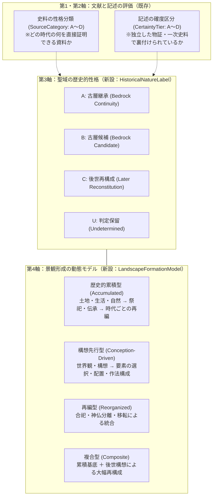

# ADR-0023: 宗教景観の意味形成過程・歴史的性格ラベル・現代再構成の直交モデリング

- Status: Accepted
- Date: 2026-10-25
- Supersedes: なし（ADR-0019 および ADR-0021 を認識論・形成史の観点から拡張）
- Related ADRs:
  - [`0019-sacred-site-stratigraphy-and-deity-context-architecture.md`](./0019-sacred-site-stratigraphy-and-deity-context-architecture.md)
  - [`0021-dual-cognitive-orthogonality-and-fsm-architecture.md`](./0021-dual-cognitive-orthogonality-and-fsm-architecture.md)
  - [`0022-ground-anchor-polyhedral-projection-and-context-invariance.md`](./0022-ground-anchor-polyhedral-projection-and-context-invariance.md)
- Related Policies:
  - [`docs/source-evaluation-and-stratigraphy-policy.md`](../source-evaluation-and-stratigraphy-policy.md)

---

## 1. Context (背景と課題)

### 1.1 現代宗教空間と「古層」の境界問題
ResoWorld はこれまで、「現在の祭神や後世の社伝と、考古・古代史料で確認できる基底層を分離する」という方針（ADR-0019）のもとで、古代の古層祭祀景観の復元に取り組んできた。

しかし、2026年10月25日の探索（福岡県糟屋郡須恵町・宝満神宮寺）において、以下の典型的な宗教景観に直面した：
- 境内には奈良大神神社の三ツ鳥居を模した鳥居、香椎宮の綾杉（御神木）の古木木片、太宰府宝満山神宮寺（明治廃寺）の寺院名、八大龍王、鹿島神宮建御雷之男神、観音真言などが網羅的に集約されている。
- 法人登記および土地利用履歴上、1990年代初頭まで森林原野であり、1994年以降に教祖の神示に基づいて造営された単立宗教法人である。

### 1.2 従来の二元論的限界
このような空間を前にした際、従来の「古代の祭祀が継承されているか否か」という単一の評価軸では、以下の課題が生じていた：
1. **「古層がない＝偽物・低価値」という安易な排除**:
   古層の証拠がないからといって単に無視することは、近現代における宗教景観の形成史や、現代の人々が実践している信仰空間の客観的分析を放棄することになる。
2. **意味の形成プロセスの不可視化**:
   異なる由来を持つ歴史的シンボルが、どのような宗教的構想（神示・霊的シンクレティズム等）に基づいて集約され、参拝者の体験（作法・唱句等）として演出されたのかという「意味形成の動態」を記述する枠組みが不足していた。

---

## 2. Decision (あるべき設計憲章と新アーキテクチャ)

本決定をもって、ResoWorld に以下の 3 つの直交概念および分析規約を正式に導入する。

### 2.1 聖域の歴史的性格ラベル (HistoricalNatureLabel)
聖域・スポットにおける祭祀の歴史的性格と証拠の状態を以下の 4 区分で管理する：
- **`A_BEDROCK_CONTINUITY`（古層継承）**: 当該地点における古い祭祀の存在を示す客観的証拠（考古遺構・同時代史料）があり、継承・変遷の歴史を検討できる。
- **`B_BEDROCK_CANDIDATE`（古層候補）**: 古層の手がかり（山岳景観、古木、神楽、伝承）はあるが、成立年代や継続性が未確定。
- **`C_LATER_RECONSTITUTION`（後世再構成）**: 後世の勧請・祭神変更、または近現代の宗教的構想に基づき、祭祀体系が新造・再構成されたことが確認できる。
- **`U_UNDETERMINED`（判定保留）**: 判断材料が不足している。推定で補わない。

### 2.2 宗教景観の形成過程モデル (LandscapeFormationModel)
意味が形成されたプロセスを以下の動態モデルで分類・分析する：
- **`accumulated`（歴史的累積型）**: 自然・生活・祭祀の長い時間的積み重ねによる重層化（例：宗像、大神神社）。
- **`conception_driven`（構想先行型）**: 特定の宗教的構想に基づき、既存要素を選択・配置して作られた空間（例：宝満神宮寺）。
- **`reorganized`（再編型）**: 明治合祀や近世藩政による統合・移転（例：古賀神社、宮地嶽神社山腹遷座）。
- **`composite`（複合型）**: 累積的基底と計画的構想の併存（例：宇佐神宮）。
- **`undetermined`（判定保留）**: 形成過程の資料不足。

### 2.3 意味の形成・提示過程の分析 7 項目
聖域地層プロファイルにおいて、以下の 7 項目を独立して記述・検証する：
1. **意味の起源 (`meaningOrigin`)**
2. **要素の導入過程 (`elementsIntroduction`)**
3. **要素間の歴史的関係 (`historicalRelation`)**
4. **意味の統合・提示方法 (`presentationMethod`)**
5. **祭祀作法の形成過程 (`ritualPracticeOrigin`)**
6. **空間体験と動線構成 (`spatialExperience`)**
7. **成立過程の可視性 (`formationVisibility`)**

### 2.4 評価対象分離の不変原則 (Invariants)
1. **A・B・C・U は価値や格付けの序列ではない**: 歴史的性格と証拠の状態を表すものであり、ラベル C を「偽物」と判定しない。
2. **祭神の神話上の古さと、当地での祭祀成立年代を混同しない**: 神話上古い神名が祀られていても、当地での成立が近現代であればラベル C となる。
3. **周辺地域の信仰史を個別施設の古さに転用しない**: 周辺霊山や古社の伝承キーワードが使われていても、当該施設の成立根拠としない。
4. **評価対象の分離**: 古層祭祀の復元と後世宗教景観の形成史を、単一の総合点やランキングに統合しない。

---

## 3. Consequences (影響と設計的シンプルさの保証)

### 3.1 非破壊的結合（Zero-Breakage & Backwards Compatibility）
- `SacredSiteStratigraphyProfile` に対して、`historicalNature`、`formationModel`、`formationAnalysis` を**オプショナルフィールド**として追加する。
- 既存の 18 件の地層プロファイル、全テスト、ビルドに対して一切の回帰・不整合を起こさない。

### 3.2 宣言的データ駆動（No Whack-a-Mole）
- 手続き型の分岐（`if (spot.name.includes("宝満神宮寺"))` 等）を一切排除し、すべてスキーマ定義された宣言的データとしてプロファイル内に記述する。
- 宝満神宮寺はラベル C（構想先行型）、太祖神社下宮はラベル B（古層候補）として整然と実体化される。

### 3.3 地層適格性（Stratigraphic Eligibility）と現代宗教景観の分離
- **課題**: 宝満神宮寺のような平成期新造の単立宗教法人が、境内の「和の宮磐座（模倣）」「八大龍王」「神宮寺」といったキーワードにより、第1層（古代アニミズム）や第4層（中世神仏習合）に誤認マッチし、古層祭祀の重層性を味わう地層マップのノイズとなる問題。
- **決定**:
  - ResoWorld の「地層（Stratum L1〜L5）」は「前近代からの歴史的・共同体的な祭祀の堆積（累積・再編）」に限定する。
  - **「土地の歴史的連続性を持たない戦後〜現代の新設単立宗教施設（ラベルC・構想先行型・最古記録が現代）」は、地層適格性なし（Non-Stratum）**として地層マップから除外する。
  - 一方、昭和27年村社4社合祀の**古賀神社**は、千年の産土共同体祭祀の再編（`reorganized` / ラベルB）として、正当に**第5層（近代・現代再編層）および古層構成要素**として地層マップに投影される。
  - これにより、地層マップを100%清浄に保ちつつ、旅行記では客観的現代景観として批判的解剖を両立する。

### 3.4 時代レンジ整合原則（Era Temporal Alignment Principle）
- Claim の `historicalTime` が指定されている場合、その時代区分が地層の時代レンジ（L1=先史〜古代初期、L2=古墳・飛鳥、L3=奈良・平安律令、L4=平安末〜中世、L5=近世〜現代）と整合しない限り、当該地層の積極的成立根拠（basis）としてはマッチさせない。
- 現代の施設に対する客観的観察文が、古代・中世の地層に誤爆する構造的リスクを根本的に遮断する。
