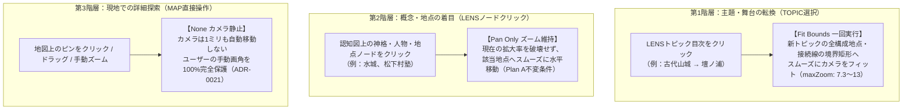

# ADR-0024: 地図カメラナビゲーション階層原則とLENSトピック選択UX不変条件 (Camera Navigation Hierarchy and Topic Transition UX Invariants)

- Status: Accepted
- Date: 2026-11-05
- Related ADRs:
  - [`0021-dual-cognitive-orthogonality-and-fsm-architecture.md`](./0021-dual-cognitive-orthogonality-and-fsm-architecture.md)
  - [`0022-ground-anchor-polyhedral-projection-and-context-invariance.md`](./0022-ground-anchor-polyhedral-projection-and-context-invariance.md)
  - [`0012-separate-map-connection-selection-from-focus.md`](./0012-separate-map-connection-selection-from-focus.md)

---

## 1. Context (背景と課題)

### 1.1 ウォッシュズーム問題（視界破壊）の歴史的教訓
過去の地図実装において、地物やノードの選択状態が変化するたびに地図カメラが自動で `fitBounds`（全体ズーム＆パン）を実行していた。
この挙動は、ユーザーが太宰府や宗像などの特定地域を拡大してじっくり探索している最中に、何かをクリックするたびに「九州全域や西日本全域へとカメラが勝手に引き戻される（ウォッシュズーム）」という深刻な認知的ストレスを生んでいた。

これに対処するため、以下が導入された：
1. 自動ズーム（`autoZoom`）をデフォルト OFF に設定し、地図ツールバーの明示的チェックボックス化。
2. 地図右上に手動の `[⛶ 全体を表示]` ボタンを常設。
3. LENSノード選択時はズーム倍率を破壊せずパン（`panCamera: true`）のみを行うカメラポリシー（Plan A不変条件）。

### 1.2 トピック連続切り替え（ポチポチ体験）における新たな課題
LENSパネルのGUI刷新（常設スプリット目次サイドバー導入）により、ユーザーが異なる歴史トピック（例：「白村江後の古代国防・山城」 $\rightarrow$ 「壇ノ浦の合戦と平家終焉」 $\rightarrow$ 「宗像三女神の海洋祭祀」）をテンポよく連続してポチポチ切り替える探索スタイルが定着した。

しかし、トピック選択時もカメラが全く動かない場合、以下のような不整合が生じた：
- 直前に「太宰府周辺（水城・大野城）」を見ていた状態で、下関・門司の「壇ノ浦合戦」トピックを選んでも、地図の視界は太宰府のままとなり、関門海峡で何が起きているか（ラインやピン）が画面外になって見えない。
- 「トピック切り替え」は個別地点の確認ではなく、「探索の舞台・空間スケールそのものの転換」であるため、全体像がパッと画面に収まるフォーカスが不可欠である。

### 1.3 プリセット再利用によるトピック名称・内容の混同
旧朝倉パック統合時の暫定実装により、ルート側の「拠点環濠集落と弥生首長層・王墓ネットワーク」と政治側の「低湿地多重環濠と内陸拠点集落の構造」が同一の `presetId` を共有していた。
さらにアーキタイプUI側で `projection.title`（プリセット名）を直参照していたため、政治側を選んでもルート側のタイトル・図面が表示される情報混同が発生していた。

---

## 2. Decision (決定内容)

### 2.1 地図カメラナビゲーションの 3 階層原則 (Three-Tier Camera Policy)

地図カメラの自動制御は、ユーザーの「操作意図の粒度」に応じて以下の 3 階層に厳格に分離・統一する。

#### 不変条件 1（TOPIC選択時の全体像フォーカスと 1 回限定保証）
- トピック選択時（`onSelectTopic`）、前トピックの個別スポット選択は即座に解除（`clear-focus`）され、地図カメラは新トピックの全構成地点および接続線（`viewportPoints`）の矩形へスムーズに `fitBounds` する。
- この全体フィットは**トピック切り替え時に 1 回のみ**ディスパッチされる（`topicKey !== lastPannedKey`）。
- 同一トピック内での再レンダリングや、ユーザーがそのトピック内で手動拡大・移動した後は、再フィットは一切発火しない。

#### 不変条件 2（Plan A：個別ノード選択時のズーム倍率保護）
- LENS認知図内の個別ノード（神格、集団、地点等）をクリックした際は、カメラは現在のズーム倍率を維持したまま、該当地点へスムーズにパン（スライド移動）するのみとする。
- ノードをクリックしただけで勝手に全体へズームアウトする挙動（ウォッシュズーム）は厳禁とする。

#### 不変条件 3（MAP直接クリック時のカメラ静止）
- 地図上のピンをクリックした際、カメラは自動移動を行わない（`{ type: "none" }`）。
- 地図は純粋なディスプレイ端末（ADR-0021）であり、手動探索中のユーザーの視界をシステムが奪ってはならない。

---

### 2.2 ナレッジプリセット 1:1 独立性原則 (Preset Orthogonality)

1. **プリセットの独立定義**:
   - すべての登録トピック（`canonicalKnowledgePackTopicMappings`）は、独立した目的と関心事を持つため、原則としてトピックごとに固有の `presetId` を割り当てる。
   - 「低湿地多重環濠と内陸拠点集落の構造」には `data/knowledge-packs/yayoi-archaeology-network.json` 内に独立したプリセット `asakura-social-structure` を定義し、平塚川添遺跡・甘木歴史資料館・吉野ヶ里を中心とする筑後川・有明海回廊に特化させる。
2. **UI表示の正本統一（ボーイスカウトルール）**:
   - すべての認知アーキタイプコンポーネント（`ComparisonMatrixLens`, `GenealogyTreeLens`, `HubSpokeTopologyLens`, `FactionNetworkLens`, `SequenceRouteLens`）のヘッダータイトルは、下流プリセットの `projection.title` ではなく、正本トピックの `topic.label` を主見出しとして表示する。

---

## 3. Consequences (影響と検証)

### 3.1 得られた成果
- **極上のトピック連続ポチポチ体験**:
  目次サイドバーでトピックを切り替えるだけで、右ペインの認知アーキタイプ図と同時に、左ペインの地図カメラが「その歴史の舞台（太宰府、関門海峡、玄界灘、有明海）」へとスムーズに滑らかに切り替わる。
- **視界破壊ゼロ**:
  トピックの舞台に入った後の個別ノード観察や手動ズームは完全に維持され、予期せぬズームアウトが発生しない。
- **データ存在論の完全対称性**:
  トピックタイトルと認知図・地図接続線が 1:1 で一致し、情報の混同が根絶された。

### 3.2 自動テストによる恒久保護
- [`camera-policy.test.ts`](file:///b:/09_Technology/22_ResoWorld_bionic/apps/web/src/domain/map/camera-policy.test.ts) にて、トピック選択時の一回限定 `fitBounds`、同一トピック内の静止保証、別トピック遷移時の再フィット保証が単体テストとして恒久化されている。
- ナレッジパック整合性テスト（`all-lens-topic-integrity.test.ts`, `pack-loader.test.ts`）により、全プリセットとトピックの 1:1 整合が保証されている。
