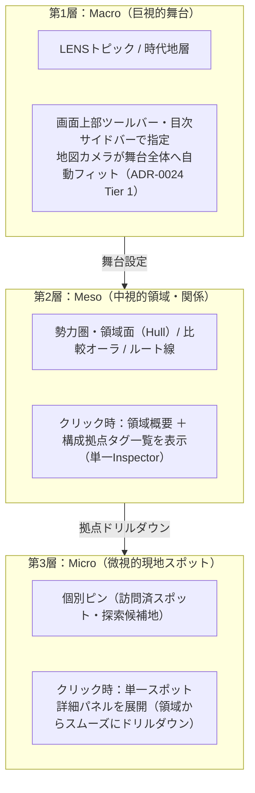

# ADR-0025: 空間認知の3階層モデル（Macro/Meso/Micro）と単一インスペクター・視覚的直交UI設計規範 (Spatial UI Interaction and Three-Tier Inspection Policy)

- Status: Accepted
- Date: 2026-11-08
- Related ADRs:
  - [`0021-dual-cognitive-orthogonality-and-fsm-architecture.md`](./0021-dual-cognitive-orthogonality-and-fsm-architecture.md)（二大直交モデル・単一FSM・事前実体化）
  - [`0024-camera-navigation-and-lens-topic-ux-invariants.md`](./0024-camera-navigation-and-lens-topic-ux-invariants.md)（カメラ3階層原則）
  - [`0012-separate-map-connection-selection-from-focus.md`](./0012-separate-map-connection-selection-from-focus.md)（フォーカスと選択の分離）

---

## 1. Context (背景と課題)

### 1.1 地図上における空間要素の三元化（線・面・オーラ）
本リポジトリではこれまで、すべての関係性を「折れ線（Line）」で描画していた。しかし、これには重大な認知摩擦が存在していた：
- 並列比較（例：宗像・阿曇・住吉の海人族三系統）を折れ線で結ぶと、不自然なジグザグ旅行ルートに見えてしまう。
- 地域クラスタや防衛ライン（例：伊都国王墓群、大宰府の三連山城要塞網）を折れ線で結ぶと、面的な勢力圏・領域の広がりが伝わらない。

これに対し、以下の**空間表現の三元化**を導入した：
1. **物理移動・航路**: 実線・破線の折れ線（`route` / `line`）
2. **並列比較・対比**: 線なし＋テーマカラーの同期発光オーラ（`focus-only`）
3. **勢力圏・領域**: 半透明ポリゴン面（Convex Hull 凸包）＋外周点線（`hull` / `perimeter`）

### 1.2 UI・状態管理における新たな競合リスク
表現力が増した結果、以下の設計上の競合リスクが浮き彫りとなった：
1. **二重インスペクション（窓の乱立）**:
   領域面（Convex Hull）をクリックした状態と、その内部にある個別スポット（水城跡など）をクリックした状態が画面上で同時に発生し、詳細パネルが複数重なって地図が覆い隠される。
2. **クリック判定の競合（Hit-testing Conflict）**:
   領域ポリゴンの中にあるピンをクリックしようとした際、背後の面が反応してしまいピンを選択できない。
3. **時代地層（Stratum）と領域面（Lens）の境界侵犯**:
   地層スライサーを動かした時に勝手にレンズを書き換える等の暗黙同期を行うと、ADR-0021 の単一FSM原則（直交性の維持）が破壊される。

---

## 2. Decision (決定内容)

過去の教訓と ADR-0021 / ADR-0024 の原則に基づき、以下の **「空間UI設計ポリシー（4大原則）」** を正本仕様として制定する。

---

### 原則 1: 空間認知の3階層モデル（Macro ➔ Meso ➔ Micro）
ユーザーの歴史探索体験は、常に**「舞台を見る（Macro） ➔ 勢力圏・関係を俯瞰する（Meso） ➔ 個別地点へ降り立つ（Micro）」**という自然な解像度ズームイン（ドリルダウン）として設計する。
- **Macro**: トピック、時代地層（画面上部ツールバー・目次サイドバー）
- **Meso**: 勢力圏・領域面（`hull`）、外周境界線（`perimeter`）、比較オーラ（`focus-only`）、移動ルート（`route` / `line`）
- **Micro**: 個別の現地スポット・未訪問候補ピン

---

### 原則 2: 単一インスペクター原則（One Inspector at a Time / 窓の乱立禁止）
地図上に浮遊する詳細カード（Inspector）は、**画面上に常に最大1つ**とする。
- **Meso（領域）をクリックした時**:
  - `mapConnectionInfo`（領域カード）が開き、領域の「歴史的性格（防衛網、首長墓群など）」と**「含まれる拠点タグ一覧（[水城跡] [大野城跡] [基肄城跡]）」**を表示する。
- **Micro（ピン）をクリックした時**:
  - 即座にスポット詳細パネルが主役となり、領域カードは静かに閉じる（領域の所属情報はスポットパネル内にバッジとしてスマートに引き継ぐ）。
- **ドリルダウン連携**:
  - 領域カード内の拠点タグをクリックした場合、スムーズに Micro（個別ピン選択）へと遷移し、地図カメラは該当地点へパン（Pan Only、ADR-0024 Tier 2）する。

---

### 原則 3: クリック判定の厳格な階層化（Hit Precedence: Micro > Meso > Macro）
同一座標に複数の要素が重なっている場合、判定優先度を以下のように厳格化する：
1. **最優先**: 個別ピン（`mapMarker`）
2. **第2優先**: 領域の外周境界線（`mapHullBorder`）
3. **第3優先**: 領域の半透明背景面（`mapHullBase`）
4. **第4優先**: 地図背景（クリックで選択解除）

※「領域の中にあるピンをクリックしようとしたのに、背後の面が反応してピンが選べない」という操作摩擦を100%排除する。

---

### 原則 4: 視覚的投影による直交表現（Visual-Only Orthogonality / ADR-0021）
時代地層（Stratum）と領域（Hull）の連動において、**FSMの裏で状態を同期させる（直積バグ）ことを厳禁**とする。
- 連動はすべて**「純粋な視覚的投影（Visual Projection）」**で行う。
  - 例：地層で「弥生時代」選択時 ➔ 弥生の領域（伊都国王墓群）は鮮明に点灯、古代の領域（大宰府防衛網）は自動的に半透明度を落とす（`opacity: 0.15` ゴースト化）または非表示。
  - FSM 内部の状態（選択中の地層やトピック）は互いに書き換わらず、クリーンな直交性を維持する。

---

## 3. Consequences (影響と検証)

### 3.1 得られる成果
1. **階層的な探索の快感**:
   「伊都国とは何か（Meso：領域）」を理解した上で、領域内の「平原王墓（Micro：個別地点）」へ迷わず自然にドリルダウンできる。
2. **画面の絶対的な静けさ**:
   複数のカードやダイアログが地図を覆い尽くすことがなく、常に地図と主情報だけが端正に表示される。
3. **アーキテクチャ不変条件の死守**:
   ADR-0021 の単一FSMと事前実体化原則を犯すことなく、高度な連動表現を実現できる。

### 3.2 不変条件テスト
- 領域カード内の拠点一覧レンダリングと、拠点クリック時のスムーズなスポット選択遷移をテストスイートで保証する。
- 時代地層選択時の非該当領域ゴースト化（CSS投影）が、FSM状態に副作用を及ぼさないことをスライステストで検証する。
