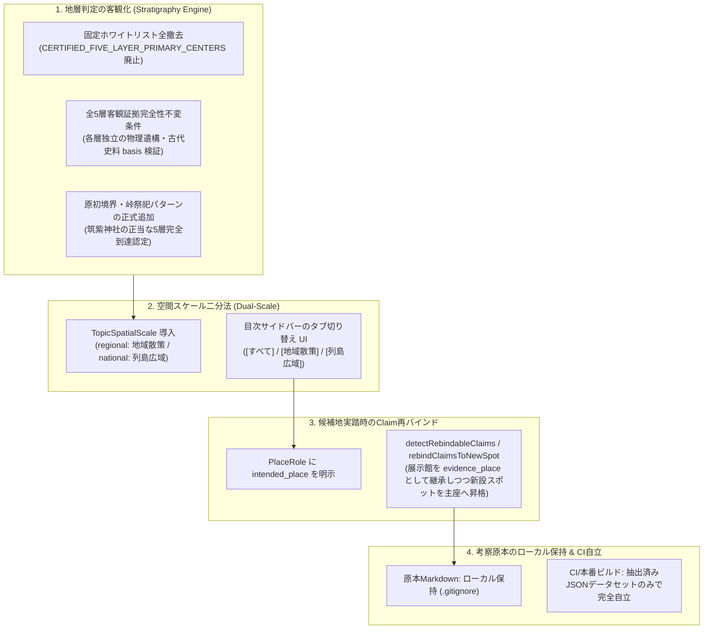

# ADR-0026: 地層判定ホワイトリストの完全撤廃・空間スケール二分法（Regional/National）・探索候補地Claim再バインド基盤 (Objective Stratum Invariants, Dual-Scale Lenses, and Claim Re-binding Policy)

- Status: Accepted
- Date: 2026-11-09
- Related ADRs:
  - [`0018-evidence-driven-stratum-and-anti-bias-guards.md`](./0018-evidence-driven-stratum-and-anti-bias-guards.md)（根拠駆動の地層判定とバイアス防止ガード原則）
  - [`0019-sacred-site-stratigraphy-and-deity-context-architecture.md`](./0019-sacred-site-stratigraphy-and-deity-context-architecture.md)（祭祀拠点の重層構造・祭神コンテキスト・探索ジャーニー統合アーキテクチャ）
  - [`0021-dual-cognitive-orthogonality-and-fsm-architecture.md`](./0021-dual-cognitive-orthogonality-and-fsm-architecture.md)（二大直交モデル・単一FSM・事前実体化）
  - [`0025-spatial-ui-interaction-policy.md`](./0025-spatial-ui-interaction-policy.md)（空間認知の3階層モデルと視覚的直交UI設計規範）

---

## 1. Context (背景と課題)

### 1.1 地層判定の硬直化（固定ホワイトリストによる表現力拘束の病根）
本リポジトリでは、ADR-0018 に基づき「根拠駆動の地層判定（Stratigraphy Engine）」を導入し、主観や社格バイアスを排した客観的歴史景観の積層判定を行ってきた。
しかし、テキストのキーワード曖昧一致によって意図しない小社や遺跡が無秩序に5層へ跳ね上がる「地層インフレ（サチュレーション）」を抑止する際、急場しのぎの防壁として以下の**固定ホワイトリスト**がテストコード（`stratigraphy-invariants.test.ts`）に導入されてしまっていた：
```typescript
// アンチパターン: 固定ホワイトリストによる神社のハードコード束縛
const CERTIFIED_FIVE_LAYER_PRIMARY_CENTERS = new Set([
  "宗像大社 辺津宮", "宇佐神宮", "厳島神社", "志賀海神社", "伊野天照皇大神宮",
]);
expect(fiveLayerSpots).toHaveLength(5);
```
この結果、**「客観的に古代国家、律令、神仏習合、近現代を網羅し、原初境界祭祀の物証を持つ筑紫神社のような古社であっても、テストを通すために歴史モデリングやClaimの紐付けを歪めてしまう」**という本末転倒（テスト都合の歴史データ改変リスク）が発生していた。これは AGENTS.md 原則①（もぐらたたき禁止）および原則④（固定ID・ハードコード禁止）に真っ向から抵触する重大な設計負債であった。

### 1.2 カテゴリーエラー（人工遺物とアニミズム自然崇拝の混同）
第1層（`animism`: 原初自然崇拝）の判定ルール内に `/銅鏡|内行花文鏡|副葬品/` という人工遺物のパターンが混入していた。これにより、弥生・古墳時代の青銅器（本来は第2層 `ancient-state` の首長祭祀・国家形成期の物証）が第1層に誤マッチし、判定エンジン自体の感度・精度が不安定になるカテゴリーエラーが生じていた。

### 1.3 空間スケールの混在（北部九州ミクロ散策と日本列島マクロ構想の乖離）
LENS パックの拡充（阿曇氏の内陸水運網、住吉三神の列島祭祀大系、邪馬台国比定ルートなど）に伴い、**北部九州ローカル（徒歩・車輪のフィールドワーク：Zoom 10〜14）** と **日本列島全域（数百km規模の国家形成・海運ネットワーク：Zoom 5〜8）** という、全く異なる2つの空間スケールが同一の目次リストにフラットに混在するようになった。この結果、超広域トピックを選択した際にカメラが急激に日本列島全体へズームアウトし、地域散策ピンが密集・縮退して判読不能になる認知摩擦が発生していた。

### 1.4 未踏候補地（Suggestions）実踏時のClaim引き継ぎ断絶
Option A（`atlas.spots` は 100% 実踏済みスポットのみとし、候補地を混入させない不変条件）を厳守した結果、未踏の候補地（山門老松神社、安振神社等）に関する考察Claimは展示館（九州歴史資料館等）に退避・アンカーされていた。しかし、将来ユーザーが現地へ実際に実踏・旅行記作成した際、展示館に退避させていたClaimを新設スポットへ半自動的に引き継ぎ・再バインド（Re-binding）するライフサイクル仕様が存在しなかった。

### 1.5 考察原本（ローカル思索ノート）とデータセットのポータビリティ
現地実踏ログ（旅行記）と文献考証（考察記録）の関心事を直交分離するため、考察原本を `考察/` ディレクトリに配置し `.gitignore`（ローカル保持）とした。しかし、データセット内にローカルファイルパスが直書きされていると、CI 環境や別マシンで clone された際に参照先が存在しないリンク切れとなり、ポータビリティが損なわれる懸念があった。

---

## 2. Decision (決定内容)

以上の構造的課題を根本解決するため、以下の **4大アーキテクチャ原則** を正式に採番・制定する。



### 原則 1: 客観的証拠完全性不変条件と固定ホワイトリストの完全撤廃
1. **ホワイトリストの全廃**:
   テストコードから神社名をハードコードした Set（`CERTIFIED_FIVE_LAYER_PRIMARY_CENTERS`）を完全撤廃する。
2. **客観証拠完全性不変条件（Evidence Completeness Invariant）**:
   5層に到達したスポットは、特定の神社名ではなく、**全5層（L1〜L5）のすべてにおいて独立した物理的物証または公的史料の根拠（`basis`）を完全に充足していること**をもって機械的に検証する。
3. **カテゴリーエラーの排除と自然境界祭祀の昇華**:
   - `animism`（第1層）から人工遺物（`/銅鏡|内行花文鏡|副葬品/`）を完全排除し、本来の `/巨樹|神木|禁足地/` を明文化する。
   - 古代日本における天然の境界・峠（サカ・タワ）に潜む荒ぶる神・塞の神への畏怖と鎮魂（`/峠の.*神|境の.*神|坂の神|荒ぶる神.*(?:鎮|命)|人の命を尽くす神|境界祭祀/`）を、社殿建築以前の真正な原初アニミズム形態として正式に採択する。
4. **筑紫神社の正当な5層認定**:
   筑紫神社について、現地案内板および風土記に伝わる「原田峠・境の坂の荒ぶる神」を基底層（L1）として認識し、古代首長（L2）、延喜式名神大社（L3）、中世神仏習合・山城戦乱（L4）、近世福岡藩再興・粥占（L5）の**正当な完全5層**として認定・保護する。

### 原則 2: 空間探索スケールの二分法（Regional vs National）とタブUI
1. **宣言的スケール属性の導入**:
   ```typescript
   export type TopicSpatialScale = "regional" | "national";
   ```
   LENS トピック定義（`RegisteredLensTopic`, `ResolvedLensTopic`）に `spatialScale` を持たせ、トピックの空間的射程を宣言的に二分する：
   - **`regional`（地域散策）**: 北部九州ローカル（糸島、宗像、朝倉、博多、八女等）。徒歩・車輪のフィールドワーク。
   - **`national`（列島広域）**: 海神祭祀三宮大系、邪馬台国ルート比定、阿曇内陸水運網など。国家形成・海上交易の巨視的ネットワーク。
2. **目次サイドバーのタブ切り替え UI**:
   `LensTopicSidebar` に `[すべて] [地域散策] [列島広域]` のセグメント切り替えタブを常設し、ユーザーが思考しているスケールに応じてトピック一覧を瞬時にフィルタリングできる構造とする。

### 原則 3: 意図された主題地（intended_place）によるClaim再バインド機構
1. **物証閲覧地と意図された主題地の二重保持**:
   未踏の候補地に関する考察Claimは、現在アンカーされている展示館（`evidence_place` または `observed_place`）を保持しつつ、本来の対象地を `role: "intended_place"` として明示保持する。
2. **昇格時の半自動マイグレーションエンジン**:
   候補地が実踏されて `atlas.spots` に新設された際、`detectRebindableClaims` により退避中のClaimを自動検知し、`rebindClaimsToNewSpot` によって：
   - 新設スポットを `subject_place`（主座）へ昇格。
   - 元の展示館等を `evidence_place`（物証閲覧地）へ変換して継承（物証の連続性と来歴を完全保護）。
   - スポット側の `claimIds` を同期。
   するライフサイクル基盤を確立する。

### 原則 4: 考察原本ローカル保持とCIポータビリティの完全自立
1. **原本と知識グラフのライフサイクル直交分離**:
   - `考察/` ディレクトリ（個人の思索ノート・ドラフトMarkdown）は `.gitignore` でローカル保持（非公開）とする。
   - 公開・CI に供されるのは、インポートスクリプトによって抽出・検証された**構造化データセット（`published-review-dataset.json`）および LENS パックの TypeScript コード**のみとする。
2. **CI セーフガードの必須化**:
   インポートスクリプトは、ローカル原本ファイルが存在しない環境（CIや外部clone環境）で実行された場合でも、クラッシュせず安全にスキップするセーフガードを常備する。データセット内の考察ドキュメントには `documentKind: "research-note"`, `isLocalOnly: true` を明示する。

---

## 3. Invariants & Verification (不変条件とテスト検証)

本アーキテクチャの健全性を担保するため、以下の CI ガード（テストスイート）を配備し、100% の通過を義務付ける：

1. **全層客観証拠完全性不変条件 (`stratigraphy-invariants.test.ts`)**:
   5層に到達したすべてのスポット（宗像大社、宇佐神宮、筑紫神社、厳島神社、志賀海神社、伊野天照皇大神宮）は、5層すべてにおいて有効な `basis`（物証・史料引用・マッチトークン）を完備していなければならない。
2. **保守的積層不変条件 (`stratigraphy-invariants.test.ts`)**:
   単一時代の遺跡（平原遺跡、三雲南小路遺跡など）や中規模地域社（宇美八幡宮、和田八幡宮など）は、自身の歴史的射程（1〜3層）を超えて不当に4層・5層へ跳ね上がってはならない。
3. **デュアルスケール網羅性不変条件 (`lens-topic-sidebar.test.ts`)**:
   全登録トピックは、`regional` または `national` のいずれかに排他的かつ漏れなく分類されていなければならない（`undefined` の禁止）。
4. **Claim 再バインド不変条件 (`claim-rebinding.test.ts`)**:
   新設スポットへの再バインド時、元の展示館が `evidence_place` として欠落なく保持され、関係のない他のClaimの紐付けが破壊されてはならない。

---

## 4. Future Roadmap & Non-Goals (今後の拡張境界)

- **地図レンダラーの動的 LOD 制御（Non-Goal in ADR-0026 / 次期フェーズ）**:
  本 ADR はトピック定義および認知 UI（サイドバー）のスケール分離を対象とする。列島広域モード選択時に MapLibre 側で北部九州のピン群を自動クラスタリング・間引きするレンダリング最適化は、次期 UI 改善（アプローチ A）にて実施する。
- **未踏候補地プレビュー UI（次期フェーズ）**:
  地図上の Suggestion ピンをクリックした際、`intended_place` として退避されている考察 Claim をインスペクター上にプレビュー表示する対話機能は、本 ADR の再バインド基盤の上に構築される。
