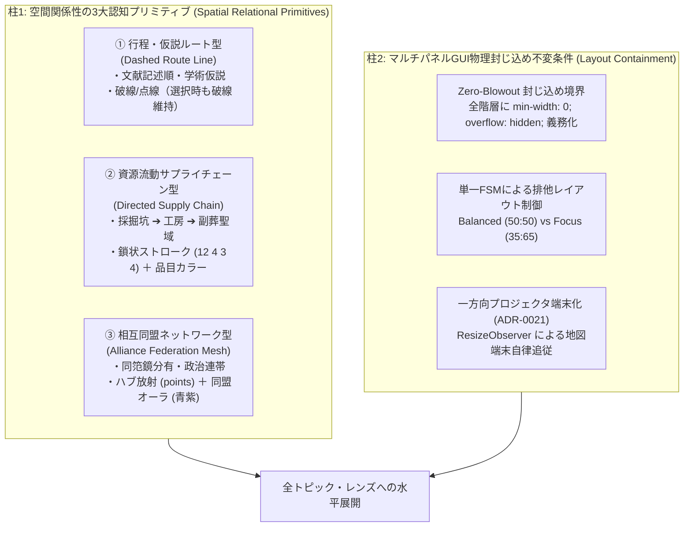

# ADR-0027: 空間関係性の3大認知プリミティブ（仮説行程・資源流動・同盟メッシュ）およびマルチパネルGUI物理封じ込め不変条件 (Spatial Relational Cognitive Primitives and Multi-Panel GUI Containment Invariants)

- Status: Accepted
- Date: 2026-11-10
- Related ADRs:
  - [`0006-unify-map-connection-projection.md`](./0006-unify-map-connection-projection.md)（地図上の接続線投影モデルの統合）
  - [`0021-dual-cognitive-orthogonality-and-fsm-architecture.md`](./0021-dual-cognitive-orthogonality-and-fsm-architecture.md)（二大直交モデル・単一FSM・事前実体化）
  - [`0024-camera-navigation-and-lens-topic-ux-invariants.md`](./0024-camera-navigation-and-lens-topic-ux-invariants.md)（カメラ操作・レンズトピックUX不変条件）
  - [`0025-spatial-ui-interaction-policy.md`](./0025-spatial-ui-interaction-policy.md)（空間認知の3階層モデルと視覚的直交UI設計規範）
  - [`0026-objective-stratum-invariants-dual-scale-and-claim-rebinding.md`](./0026-objective-stratum-invariants-dual-scale-and-claim-rebinding.md)（地層判定客観化と空間スケール二分法）

---

## 1. Context (背景と課題)

### 1.1 地理空間接続線における認知セマンティクスの喪失（一律実線のアンチパターン）
本システムでは、地図上に地点間を結ぶ接続線（`MapConnectionProjection`）を描画する機能を備えていた。
しかし、これまでの実装では、**「文献上の記述順や学術的競合仮説」「鉱物資源の産地・工房・消費地サプライチェーン」「同一鋳型（同笵鏡）の分有による政治的同盟ネットワーク」** という、全く異なる存在論的・認知的性格（Epistemic Nature）を持つ接続が、地図上で同一の単色実線としてレンダリングされるか、あるいは単なる `displayMode: "focus-only"`（線なし・ピンのオーラのみ）に縮退してしまっていた。

この結果、ユーザーが地図を見た際に：
1. 「実在した確定道路」と「文献解釈・学術仮説ルート」の区別がつかない。
2. 鉱物の「原産地 ➔ 加工工房 ➔ 副葬聖域」という長距離サプライチェーンの流動性が知覚できない。
3. 同一鋳型（同笵鏡）を共有した地域首長同士の「相互同盟・連帯ネットワーク」の地理的広がりが把握できない。
という重大な認知摩擦が生じていた。

### 1.2 CSS Grid における暗黙幅膨張と物理的突き抜け障害（Layout Blowout）
画面比率切り替え（並列 50:50 ⇄ 図を広く 35:65）およびレスポンシブ表示において、地図ツールバー（`.panelHeader`）の幅（約 684px）が、CSS Grid 子孫の暗黙の既定値 `min-width: auto` によって突っ張り、地図パネルのコンテナを強制肥大化させる事象が発生した。
この結果、操作ボタン群（`.mapFloatingCameraControls`）が右側のレンズ／地層パネルの真上へ突き抜けて重なる物理的表示崩れ（Layout Blowout）が引き起こされた。

---

## 2. Decision (決定内容)

以上の課題を根本的・体系的に解決し、本リポジトリの全トピックおよび将来のレンズへ水平展開するため、以下の **2大設計ポリシー** を正式に制定する。



---

### 柱1: 空間関係性の3大認知プリミティブ設計ポリシー

地理空間上に投影されるすべての関係性（`MapConnectionProjection`）は、以下の3大認知プリミティブ（および領域面 `hull`）のいずれかに分類され、宣言的に描画スタイルが解決されなければならない。

| 認知プリミティブ | 認知的意味論 (Semantics) | 対象テーマ例 | 地図描画規則 (Visual Rules) | 選択時不変条件 (Selection Invariant) |
| :--- | :--- | :--- | :--- | :--- |
| **① 行程・仮説ルート型**<br>`dashed-route` | 文献テキストの記述順序、および研究史上の競合仮説ルート（推測・解釈）。 | 魏志倭人伝の記述順、邪馬台国九州説・畿内説・朝倉東遷説、景行天皇巡幸路など | **破線・点線（Dashed / Dotted）**<br>・史料順: `dashArray: [10, 6]`<br>・九州説: `dashArray: [6, 6]`<br>・畿内説: `dashArray: [8, 6]` | **選択されても実線化しない**。<br>破線パターンを維持したまま白色発光（太線化）し、仮説としての性質を常に保持する。 |
| **② 資源流動サプライチェーン型**<br>`supply-chain` | 原産地（採掘坑・鉱床）➔ 一次加工工房 ➔ 副葬・消費聖域という明確な有向性を持つ物質流動。 | 糸魚川翡翠、若杉山水銀朱、花仙山碧玉、伽耶鉄器の列島流通 | **鎖状チェーン線（Chain Dash）**<br>`dashArray: [12, 4, 3, 4]`<br>＋ **品目別固有カラー**<br>（ヒスイ翠 `#34d399`、朱紅 `#f87171`、碧玉青 `#38bdf8`、鉄銀 `#94a3b8`） | 出土遺物レイヤー（Artifact Layer）の数量バブル（◇原産地、⬡工房、○出土墳墓）と幾何的に連動する。 |
| **③ 相互同盟ネットワーク型**<br>`alliance-mesh` | 物資の片道供給ではなく、同一威信財（同笵鏡・共通祭器）を分有・共有した複数首長間の無向・相互政治連帯。 | 三角縁神獣鏡の同笵鏡下賜・分有首長同盟（黒塚・椿井・車塚・石塚山・祇園山） | **同盟オーラ・放射メッシュ線**<br>`displayMode: "points"`（中枢ハブから各地域首長墓への放射）<br>＋ **青紫同盟オーラ**（`#c084fc`、`dashArray: [8, 4]`） | 構成地点のいずれかを選択した際、同盟グループ全体のノードとラインが連動ハイライトされる。 |
| **④ 領域面・勢力圏型**<br>`regional-hull` | 地点群が包括する面的な影響圏・防御圏・祭祀域。 | 宗像海人族領域、出雲国造勢力圏、水城防衛ライン | **凸包ポリゴン（Convex Hull / Perimeter）**<br>角丸半透明ウォッシュ ＋ 外周境界線 | ポリゴン内部クリックで領域全体の情報カードが開き、構成地点群がハイライトされる。 |

---

### 柱2: レスポンシブ・マルチパネルGUI物理封じ込め不変条件

マルチパネル（地図 ＋ レンズ／地層詳細）のGUIにおいて、パネル同士の干渉や突き抜け（Blowout）を物理的に根絶するため、以下の実装規範を義務付ける。

#### 1. Zero-Blowout 封じ込め境界の徹底（CSS Containment Boundary）
CSS Grid および Flexbox の子孫要素は、既定で `min-width: auto` を持ち、内部要素の最大幅（例: ツールバー、長いタイトル）まで親コンテナを押し広げる。
本システムでは、地図パネルおよび右側詳細パネルの全階層に対して、例外なく以下を適用する：
```css
/* 封じ込め境界の必須プロパティ */
min-width: 0;
overflow: hidden; /* または overflow-x: hidden; */
```
対象セレクタ：
- `.atlasGrid`, `.atlasGridWithLens`, `.atlasGridLensBalanced`
- `.mapPanel`, `.panelHeader`, `.mapHeaderToolbar`
- `.mapCanvas`, `.mapLibreShell`, `.mapLibreCanvas`
- `.lensColumn`, `.stratumPanel`, `.spotPanel`

#### 2. 単一FSMによる排他レイアウト制御（Make Illegal Layout States Unrepresentable）
画面幅の比率制御（並列 50:50 / 図を広く 35:65）は、独立したフラグではなく単一の排他状態（Tagged Union: `"balanced" | "focus"`）として管理する。
ボタンラベルおよびアクセシビリティ `title` は、現在の探索モード（STRATUM / LENS）から純粋関数として宣言的に投影（Projection）する：
- `stratum` モード時: `並列`（50:50） / `地層を広く`（35:65）
- `lens` モード時: `並列`（50:50） / `図を広く`（35:65）

#### 3. 地図端末の純粋一方向プロジェクタ化（ADR-0021 整合）
MapLibre は外付けディスプレイ端末であり、React 側のレイアウト比率変更（50:50 ⇄ 35:65）を `ResizeObserver` が検知して `map.resize()` を非同期発行する。
地図コンテナ自身が自らの幅・高さを決定することは禁止し、親の Grid Cell が与えたピクセル領域に 100% 従属する。

---

## 3. Invariants & Verification (不変条件と検証)

本ポリシーの遵守を恒久的に保証するため、以下の自動テストをテストスイートに組み込む：

1. **破線維持不変条件（`use-connection-lines.test.ts`）**:
   - `connection.appearance.dashArray` を持つ接続線は、`selected: true` となった場合でも `strokeDasharray` が `"none"` にリセットされず、破線パターンを保持すること。
2. **3大プリミティブ解決検査（`use-connection-lines.test.ts`）**:
   - 魏志倭人伝ルート群が「破線・点線」、サプライチェーン回廊が「鎖状チェーン破線＋品目色」、同笵鏡回廊が「放射メッシュ＋同盟オーラ」として導出されること。
3. **Zero-Blowout 封じ込め不変条件（`workspace-ui-invariants.test.ts`）**:
   - 地図ヘッダーの内容幅が 680px を超える極端なケースであっても、Grid Cell の計算幅が 350px 時に `mapPanel` の幅が 350px を超えて右パネルへ突き抜けないこと。

---

## 4. Consequences (影響と効果)

### ポジティブな影響
- **認知精度の劇的向上**: 「文献上の推測ルート（点線）」「列島規模の鉱物流通（チェーン線）」「初期ヤマト首長同盟（メッシュ線）」が地図上で直感的に識別可能となり、古代史の深層構造が視覚的に伝わる。
- **画面崩れゼロの堅牢性**: どのような解像度や内部コンテンツ量であっても、マルチパネルの比率が崩れず、ボタンが他パネル上へ浮遊する不具合が原理的に根絶される。
- **水平展開の容易性**: 今後追加されるすべてのトピック・ナレッジパックは、3つの認知プリミティブのいずれかを指定するだけで、自動的に最適な地図表現が与えられる。
