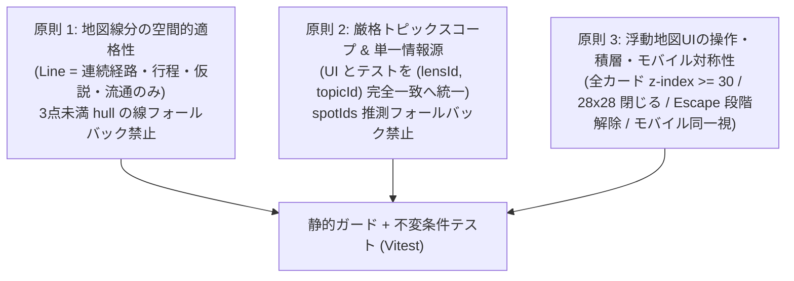

# ADR-0028: 地図線分の空間的適格性・厳格トピックスコープ・浮動UI対称性規範 (Map Line Legitimacy, Strict Topic Scoping, and Floating UI Symmetry)

- Status: Accepted
- Date: 2026-11-18
- Related ADRs:
  - [`0012-separate-map-connection-selection-from-focus.md`](./0012-separate-map-connection-selection-from-focus.md)（フォーカスと選択の分離）
  - [`0015-unified-lens-connection-data-model.md`](./0015-unified-lens-connection-data-model.md)（統合LENS接続データモデル）
  - [`0025-spatial-ui-interaction-policy.md`](./0025-spatial-ui-interaction-policy.md)（空間認知の3階層モデルと視覚的直交UI設計規範）
  - [`0027-spatial-relational-primitives-and-containment-invariants.md`](./0027-spatial-relational-primitives-and-containment-invariants.md)（空間関係性の3大認知プリミティブと物理封じ込め不変条件）

---

## 1. Context (背景と課題)

ADR-0025 および ADR-0027 で空間表現（線・面・オーラ）と視覚的直交性を導入した後も、実運用のデータセットおよび UI レイヤにおいて以下の3系統の構造的ノイズ・操作摩擦が顕在化した。

1. **非経路テーマへの線表現と退行フォールバック（Spaghetti Line Bleed）**:
   - 物理的な行程・連続回廊ではない概念対比（例：資料館同士の比較、境内社同士の祭祀関係、伝承比較）に `displayMode: "line"` が付与され、地図上の官道・防壁などの構造線と視覚的に混線していた。
   - さらに 2地点しか持たない `displayMode: "hull"` に対し、[`projectConnectionGeometry`](../../apps/web/src/app/review/use-connection-lines.ts) が頂点数3未満時に polyline（折れ線）へフォールバックしていたため、意図しない直線が描画されていた。
2. **検証式とUI実装の乖離によるトピック越境漏れ（Spec/Test/Runtime Split）**:
   - 不変条件テスト（[`all-lens-topic-integrity.test.ts`](../../apps/web/src/domain/lenses/all-lens-topic-integrity.test.ts)）は `(lensId, topicId)` の厳格一致を検査していた一方、UIフック（[`useAtlasKnowledgeConnections`](../../apps/web/src/app/review/use-atlas-knowledge-connections.ts)）に `spotIds` 部分一致の救済フォールバックが残存しており、`topicId` 欠損・不整合データが別トピックの地図へ漏れ出していた。
   - また、LENS のテーマ軸が誤って `connectionKind: "itinerary"` と分類されたり、廃止・旧名称の `topicId`（`ancient-chieftains-preset`、`yayoi-archaeology-network` 等）や `lensId` 不整合がデータ内に残存していた。
3. **浮動地図カードの操作・重なり・モバイル非対称性（Asymmetric Floating UI）**:
   - 接続情報カード（`.mapConnectionInfo`）のみ改善された結果、出土遺跡カード（`.mapArtifactCard`）の `z-index` が `10` に留まり `.eraRail`（`28`）やアクティブピンの背後に隠れる問題、閉じるボタンの規格不統一、`Escape` キー解除の非対応、およびモバイル地図下部の `.mobileSelectionCard` で接続選択時にカードと閉じる手段が欠落する非対称性が残っていた。

---

## 2. Decision (決定内容)

再発や個別パッチ（もぐらたたき）を根絶するため、以下の **3つの上位設計原則** を正本規範として制定する。

---

### 原則 1: 地図線分の空間的適格性（Spatial Line Legitimacy）

地図上に折れ線（`"line"`）を描画してよいのは、**その線自体が空間的な連続軌道・移動経路・供給鎖・比較仮説ルートを表す場合** のみに限定する。

1. **表現選択の決定表**:
   - **実際に辿る・繋がる連続空間**（訪問行程 `itinerary`、連続地形回廊、官道、航路、資源流通サプライチェーン、競合仮説ルート） ➔ `displayMode: "line"`（必要に応じて破線・チェーン線を併用）。
   - **地点間の概念比較・展示対比・同格併存・境内社連携** ➔ `displayMode: "focus-only"`（線は描かず、ピン選択時のオーラ発光とインスペクター説明のみで関係を示す）。
   - **面的な広がり・統御領域・防衛圏（3地点以上）** ➔ `displayMode: "hull"` または `"perimeter"`。
2. **退行フォールバック禁止**:
   - 構成点が3頂点未満の `"hull"` を定義してはならず、[`projectConnectionGeometry`](../../apps/web/src/app/review/use-connection-lines.ts) も3頂点未満の場合は polyline へ退行せず `{ segments: [] }` を返す。

---

### 原則 2: トピックスコープの厳格一致と単一情報源（Strict Topic Scoping & SSOT）

UI 表示ロジックとテストスイートは、トピック所属判定において **完全に同一の照合規則（SSOT）** を共有しなければならない。

1. **`(lensId, topicId)` 完全一致の強制**:
   - LENS トピックが選択されている場合、[`useAtlasKnowledgeConnections`](../../apps/web/src/app/review/use-atlas-knowledge-connections.ts) は `connection.lensId === selectedRecognitionLens && connection.topicId === effectiveTopicId` のみを表示対象とし、`spotIds` の重複や `facets` による曖昧な推測フォールバックを行わない。
   - 個別スポット詳細パネル／STRATUM 文脈にのみ属する接続は `topicId: null`（または未設定）として明示し、特定 LENS トピックの地図へ混入させない。
2. **`itinerary` 分類の純潔性**:
   - `connectionKind: "itinerary"` は実際の旅程（`lensId === "itinerary"` または `id` が `itinerary-` で始まるもの）に限定し、特定の LENS テーマ軸へ流用しない。
3. **登録レジストリとの静的整合**:
   - `topicId` を持つすべての接続および探索候補は、[`registeredLensTopics`](../../apps/web/src/domain/lens-packs/knowledge-registry.ts) に実在するトピックを参照し、`lensId` は対象トピックの `perspectiveId` と厳密に一致させる。

---

### 原則 3: 浮動地図UIの操作・重ね順・モバイル対称性（Floating Map UI Symmetry）

地図上にオーバーレイ表示されるすべての詳細カード・インスペクターは、**どの種類であっても同じ操作性・視認性・閉じる手段** を備えなければならない。

1. **閉じる手段の対称化**:
   - `.mapConnectionInfo` / `.mapSpotInspector` / `.mapSuggestionInspector` / `.mapArtifactCard` の閉じるボタンは同一規格（`28px × 28px` の明確なボーダー付きボタン）で統一する。
   - `Escape` キーにより開いている浮動UIを段階的に閉じられること（全画面グラフ展開終了 ➔ 出土カード・選択肢解除 ➔ フォーカス・ピン留め接続解除の順で `preventDefault()` により衝突なく伝播制御する）。
2. **重ね順（Stacking Context）の保証**:
   - すべての地図上浮動詳細カード（`.mapArtifactCard` を含む）は `z-index >= 30`（ドラッグ中 `32`）とし、地図マーカーや `.eraRail`（`28`）より必ず前面に配置する。
3. **モバイル表示の対称化**:
   - モバイル（`max-width: 768px` / `760px`）において、地図上カードには画面内に収まる左右・高さ制約を適用し、地図直下の `.mobileSelectionCard` でも「地点」「候補」「接続テーマ」のいずれを選択していても概要と `×` 閉じる操作を提供すること。

---

## 3. Invariants & Verification (不変条件と検証)

本 ADR の遵守は、以下の自動テストおよび静的検査によって継続的に強制される：

1. **データ・スコープ整合不変条件（[`all-lens-topic-integrity.test.ts`](../../apps/web/src/domain/lenses/all-lens-topic-integrity.test.ts)）**:
   - 非旅程テーマが `connectionKind === "itinerary"` に誤分類されていないこと。
   - `displayMode === "hull"` の全接続が3地点以上を持つこと。
   - `topicId` を持つ全接続・全候補が登録済みトピックを参照し、`lensId` が `perspectiveId` と一致すること。
2. **幾何退行防止テスト（[`use-connection-lines.test.ts`](../../apps/web/src/app/review/use-connection-lines.test.ts)）**:
   - 2点のみを持つ `displayMode: "hull"` が折れ線へフォールバックせず `{ segments: [] }` を返すこと。
3. **UI積層不変条件（[`architecture-invariants.test.ts`](../../apps/web/src/domain/lenses/architecture-invariants.test.ts)）**:
   - `.mapSpotInspector` / `.mapSuggestionInspector` / `.mapConnectionInfo` / `.mapArtifactCard` がすべて `z-index >= 30` かつ `.eraRail` およびアクティブマーカーより前面であること。

---

## 4. Consequences (影響と効果)

- 新しい旅行記の取り込みやナレッジパック追加時、テストスイートが未登録 `topicId`・不整合 `lensId`・不十分な `"hull"`・誤分類 `itinerary` を即座に検知するため、地図の線漏れや UI 破綻を事前防止できる。
- どの種類カード（接続／地点／候補／出土遺跡）を開いても同じ見た目・操作感・キーボード操作（`Escape`）・モバイル操作で迷いなく扱えるようになる。
